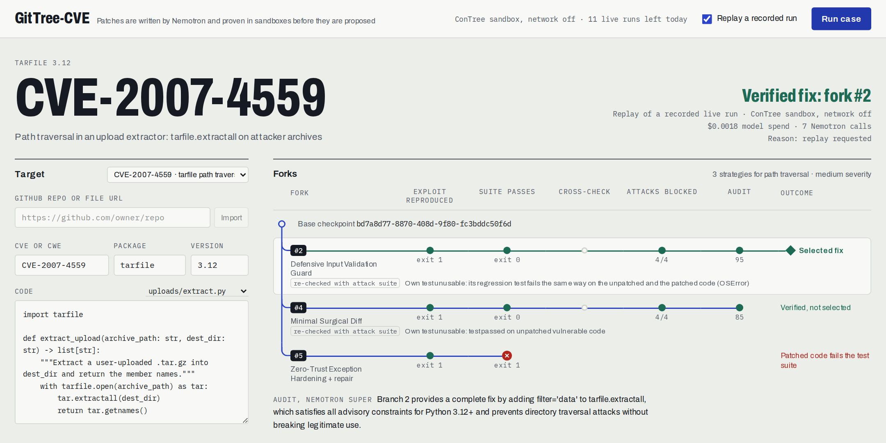

# GitTree-CVE

**Speculative, sandbox-verified CVE remediation on Nebius Token Factory + NVIDIA Nemotron.**



Dependabot-style tools bump a version string and hope the build survives. Single-threaded coding agents mutate one working tree and can't prove their fix works. GitTree-CVE generates several candidate patches in parallel, forks one network-disabled ConTree VM per candidate from an immutable checkpoint, and only proposes a patch that is **proven to fix the exploit**:

1. **Phase A:** the candidate's regression test must *fail* on the unpatched code, and every failure must count as evidence. Two kinds count:
   - a failed check: an `assert`, `pytest.fail` or `pytest.raises`;
   - a crash raised in the code the patch changes, for example the `RecursionError` of a DoS, or tarfile rejecting a member the extraction code let through.

   A test that passes on vulnerable code gives no evidence. So does one that fails any other way:
   - a `NameError`, or an `AttributeError` or `TypeError` on a name or argument only the patch adds;
   - an exception raised outside the code the patch changes;
   - an import or collection error, an async test with no async plugin, or a test that calls a fixture itself.

   A run with no result (pytest never printed its summary, or the sandbox returned no exit code) is rejected too. Phase A never shows what the test prints, so printed text can't pass for pytest's report. A model answer that couldn't be parsed is never run.
2. **Phase B:** the patched code plus the full existing suite must *pass*, and pytest must report every regression test as passed (an exit code of 0 alone is not a pass). The gate reads pytest's output the same way whatever the repository's own pytest config sets (`-q`, `-x`, `--color=yes`, `--tb=no`, `testpaths`, `python_files`). Repository tests that fail only for lack of something the sandbox doesn't have don't count against the patch: a missing module, a connection it can't make, or a module that fails to collect. Such a failure is listed as pre-existing when the unpatched suite, run once per run in the same network-disabled sandbox, fails the same way (same test id and exception). A failed check or any other exception always fails the fork, since it can be the repository's own test of the vulnerability failing on a patch that missed a case.
3. **Patch policy:** a patch may only change the repository's code. These are dropped before anything runs, and listed on the fork with the reason:
   - changes to tests (including files the repository's `python_files` setting collects), `conftest.py` and pytest configuration (including the pytest sections of `pyproject.toml`/`setup.cfg`);
   - interpreter start-up hooks, package metadata and compiled files;
   - a new module that would shadow the standard library, the test runner or one of the repository's own modules from any directory that can be on `sys.path` (test folders, `pythonpath`, `src/`, package directories, the repository root), including a module placed beside a namespace package of the same name;
   - a new module or package named like a library the repository imports or declares in `requirements*.txt`, `pyproject.toml`, `setup.cfg` or `setup.py` (a root `jwt.py` would otherwise be imported instead of PyJWT);
   - repository code that starts referring to pytest.
4. **Cross-validation:** when at least two branches have a working exploit test of their own, each passing patch also runs against every *other* branch's exploit test (including tests from branches whose own patch failed). Only tests that some patch satisfies are counted, so a disputed spec doesn't count against a patch.
5. **Fixed attack catalog:** for three classes, deterministic payloads written as code, not by a model, are run against the unpatched code. Every payload that succeeds there must be blocked by the patch:
   - **Path traversal** (`tarfile`): `../`, nested `../` (after a `docs/` directory member, as in a real archive), absolute paths, symlink and hardlink members.
   - **SQL injection:** tautology, comment truncation, `UNION`, boolean bypass, keyword-free operator tautologies (`x'<>'y`, `x' IS NOT 'y`, `x' GLOB '*`), a tautology without spaces, a numeric-context tautology (`0 OR 1=1`) and a double-quoted one. These catch the usual keyword, whitespace and operator blacklists that still let a quote through.
   - **JWT signature verification:** a token signed by the wrong RSA key, `alg: none`, HS256 with an attacker secret, tampered claims, HS256 keyed with the server's public key (key confusion), an attacker key embedded in the header (`jwk`), a server-signed token that expired 30 days ago, and a forged token for an ordinary user with no `exp` claim (so a fix that checks signatures only on admin tokens, or only on tokens that carry an expiry, is caught).

   Each class also has a **legitimate-use control**: a normal archive member is extracted, the rows the adapter inserted are found, a token the server really signed is accepted. A patch that breaks it, for example by rejecting everything, gets no credit for any payload.

   A model writes only a small adapter that binds the payloads to the repo's API. A **probe check** confirms at runtime (by profiling which code runs, not by reading imports) that the adapter really calls the repository's code. Code that runs only because the adapter imports a module doesn't count. For SQL, a second probe check requires that two values never inserted get the same result and a value the adapter inserted gets a different one. Payloads are judged against that "not found" result, so lookups that return wrappers (`{"count": 0, "results": []}`) or one-row aggregates (`COUNT(*)`) work. If a probe check fails, the catalog is discarded and the run says why.

   This is what catches fixes that pass their own test but still have a hole. In our live runs of CVE-2007-4559, Nano patches with a `'..' in name` check passed their own tests, but the catalog showed they missed symlink and hardlink members, and vetoed them.
6. **Audit:** Nemotron Super scores each verified patch against constraints extracted from live advisories, sees the cross-validation and catalog results, and can veto a patch that still allows the attack. The audit is required: a patch needs a score of at least `AUDIT_MIN_SCORE` (60). A fork the auditor gives no readable score is not approved, and the reason says so. If the audit can't run, nothing is proposed and escalation is not tried. The run records the threshold it used, so a replay is judged by it.

A fork whose patch is right but whose own regression test gave no usable evidence (broken, already passing on the vulnerable code, failing on it in a way that isn't evidence, or crashing the same way before and after the fix) is not thrown away. When the catalog validated, the fork is **re-checked** with the catalog as its regression test, before any repair round; the fork is then shown as "re-checked with attack suite". Forks that still fail get one Nano repair round with their own sandbox output.

If nothing survives, the run escalates (up to 2 attempts) with every branch's sandbox output and the reason each was rejected. It goes to Nemotron Ultra, or to Super when `BUDGET_SAVER_DISABLE_ULTRA=true`. When a catalog was validated, it becomes the escalation's regression test, so the model only has to make proven exploits fail. If that fails too, the run ends with **"no patch proposed"** rather than a guess.

A failure stays in its own scope:
- a model call or a sandbox run that fails fails only its own fork, with the error as the reason;
- a cross-check that can't run is not counted;
- an attack-suite run that can't run on a patch gives that patch no credit, and an attack suite that can't be built turns the catalog off for the run;
- a base checkpoint that can't be built ends the run with "no patch proposed";
- when the browser disconnects, the run stops, including the attack probe's model call.

Only a failure before the fan-out (the Tavily search, the planner call), or an unexpected error, switches a live run to replay.

**Real repositories in, draft PRs out.** Paste a public GitHub repo URL. GitTree-CVE imports its Python sources and dependencies (read in memory, never extracted to disk), including `-r` includes, `-e .[extras]` and the pytest plugins it declares (each kept only if pytest still starts with it), and runs the pipeline against the project's own test suite. It can then open a **draft PR** containing:
- the verified patch;
- a regression test file;
- a body citing the evidence: sandbox exit codes, attack-catalog results (or why the catalog did not apply), the audit score, the advisory constraints, and any pre-existing failures that were not counted against the patch.

A PR can only carry a patch this server verified (looked up by `run_id`), and only for repo owners on `GITHUB_PR_ALLOWED_OWNERS`. Where it goes is the server's record of the import, never the browser's say-so: only a run on exactly the files the server imported can open one, so editing any imported file makes the run PR-less. The PR branch starts at the imported commit, so its diff is the patch alone. [`examples/vulnerable-demo`](examples/vulnerable-demo) is a ready-made target.

Track: **Coding & Agentic Engineering**. Tavily integration targets the **Best Use of Tavily** bonus.

## Architecture

```
            ┌────────────── Tavily Search + Extract (live advisories) ──────────────┐
            │                                                                        │
            ▼                                                                        │
  Nemotron 3.5 Lightning ── plan: vuln class -> strategies, severity -> branch count,  │
   (intel planner)          advisory fixed version -> target, constraints -> prompts & audit
            │
            ▼
  ConTree base checkpoint (repo + deps, networking on) ── result_image_uuid
            │
   ┌────────┼─────────┬─────────┐        Nemotron 3 Nano: one candidate per planned strategy
   ▼        ▼         ▼         ▼        (+ the attack-catalog adapter, validated on the unpatched code)
 fork A   fork B    fork C    ...      each fork = 2 VM operations (more for large patches), networking off:
 (Phase A disposable / Phase B retained)   unpatched+test must FAIL, patched+suite must PASS
   │        │         │                     (fork lanes stream to the UI as each finishes)
   └── re-check: forks whose own test gave no evidence, against the validated attack catalog
            │
  repair: up to 3 failed forks get 1 Nano round with their own stdout/stderr (then re-checked too)
            │
  cross-validation matrix: every passing patch x every satisfiable exploit test
            │
  attack catalog: reproduced payloads must be blocked, legitimate use must keep working
            │
  Nemotron 3 Super audit (required, >= 60/100) ──> winner ──> SFT dataset ──> Token Factory /v1/files
            │ none approved                (only if verified with      (+ LoRA job when enabled)
            ▼                               its own regression test)
  escalation (Ultra, or Super on a budget; all sandbox traces) ──> re-verified + re-audited, or "no patch"
```

Every model call is logged with its Token Factory completion ID, token usage and cost. The UI streams this over SSE and shows measured spend per run. In the recorded runs it was **$0.0018–0.0026**. In our other live runs, one that escalated to Super cost $0.0044, and runs that escalated twice and still proposed no patch cost about a cent.

## Where each sponsor technology lives

| Capability | File |
| - | - |
| ConTree REST: image import, `POST /v1/instances`, operation polling, `networking.enabled=false`, retained vs disposable runs, guest-NIC probe, phase-A classification, Phase B integrity, cross-checks | [`gittree-cve-backend/app/contree_client.py`](gittree-cve-backend/app/contree_client.py) |
| Docker fallback with the same checkpoint/branch model (`docker commit`, `--network none`, no capabilities) | [`gittree-cve-backend/app/docker_sandbox.py`](gittree-cve-backend/app/docker_sandbox.py) |
| What a patch may change | [`gittree-cve-backend/app/patch_policy.py`](gittree-cve-backend/app/patch_policy.py) |
| Nemotron tier routing (Lightning planner, Nano fan-out + repair + catalog adapter, Super audit, Ultra escalation), JSON mode, reasoning toggles | [`gittree-cve-backend/app/nemotron_router.py`](gittree-cve-backend/app/nemotron_router.py) |
| Tavily Search + Extract | [`gittree-cve-backend/app/tavily_intel.py`](gittree-cve-backend/app/tavily_intel.py) |
| Fixed attack payloads, legitimate-use controls, probe checks, adapter contract | [`gittree-cve-backend/app/attack_catalog.py`](gittree-cve-backend/app/attack_catalog.py) |
| Pipeline, catalog gate, re-check, audit veto, cost ledger, run recording | [`gittree-cve-backend/app/orchestrator.py`](gittree-cve-backend/app/orchestrator.py) |
| Token Factory post-training (`/v1/files`, `/v1/fine_tuning/jobs`) | [`gittree-cve-backend/app/post_training.py`](gittree-cve-backend/app/post_training.py) |
| GitHub repo import (budgeted, in-memory) and draft PRs | [`gittree-cve-backend/app/github_repo.py`](gittree-cve-backend/app/github_repo.py) |
| Rate limiting, SSE API, PR endpoint (verified runs only) | [`gittree-cve-backend/app/main.py`](gittree-cve-backend/app/main.py) |
| Zero-key replay of recorded runs | [`gittree-cve-backend/app/replay_fixtures.py`](gittree-cve-backend/app/replay_fixtures.py), [`gittree-cve-backend/data/recorded_runs/`](gittree-cve-backend/data/recorded_runs/) |
| Dashboard | [`gittree-cve-frontend/app/page.tsx`](gittree-cve-frontend/app/page.tsx), fork lanes in [`case-tree.tsx`](gittree-cve-frontend/app/case-tree.tsx) |

## How Tavily changes execution (not just context)

The Lightning planner turns Tavily results into a structured plan, and deterministic rules route from it:

- **Vulnerability class → which patch strategies run** (and which attack catalog applies). Injection gets parameter binding; crypto/auth gets algorithm pinning; path traversal gets input validation. A CWE id fixes the class directly (CWE-22, CWE-89, CWE-347, ...).
- **Severity → how many ConTree branches are forked.** Critical gets 5; medium/low gets 3.
- **Advisory fixed version → overrides the requested target version**, shown in the UI.
- **Extracted constraints → injected into every patch prompt and used as the auditor's veto rubric.** For a CWE, the search asks for secure-coding guidance on the weakness. Pages about a specific CVE or security advisory in the library are left out, since they describe the library's own bugs, not your code; Tavily's summary goes with them, because it was written over them too. Constraints like "upgrade the package to version X" are dropped (a weakness in your code has no fixed version).
- **No sources found → the run is marked ungrounded**, with generic strategies and no constraints.

## Run it

### Zero-key judge mode (no API keys, no spend)

```bash
cd gittree-cve-backend && ./demo.sh
```

This replays a recorded real run of CVE-2007-4559. It needs Python 3.10 or newer (macOS's own `python3` is 3.9): `demo.sh` tries `python3.13` down to `python3.10`, then `python3`, and stops with a message if none is new enough. The UI's **Replay a recorded run** checkbox does the same. Live runs fall back to replay automatically when keys are missing, a rate limit is hit, or an API fails. Replays are labeled as such and use none of the live-run allowance.

Replay never invents a run: a CVE or code with no recording (even a one-character edit to a preset) shows **"Not run"**.

### Live

```bash
cd gittree-cve-backend
cp .env.example .env          # add NEBIUS_API_KEY, NEBIUS_PROJECT_ID, TAVILY_API_KEY
python3.12 -m venv .venv && .venv/bin/python -m pip install -r requirements.txt   # any Python 3.10+
.venv/bin/python -m uvicorn app.main:app --port 8000

cd ../gittree-cve-frontend
cp .env.example .env.local    # NEXT_PUBLIC_API_BASE_URL
npm install && npm run dev
```

`GET /api/health` reports which sandbox backend is active and the project's ConTree permissions. With `SANDBOX_BACKEND=auto`, the strongest available backend is used:

1. **ConTree:** VM isolation, when `/whoami` grants `spawn`.
2. **Docker:** containers with `--network none`, all capabilities dropped and memory/CPU/PID limits. They share the host kernel, so this is weaker than a VM. A container's network would be the host's own, so the base checkpoint's only networked step downloads wheels (`pip download --only-binary=:all:`, nothing built or run). Everything is then installed from those wheels with the network off. The project's build requirements and the dependencies it declares statically (`pyproject.toml`, `setup.cfg`, literal lists in `setup.py`) are downloaded too, read without running any of its code. Each requirement needs a wheel for the image's platform, and dependencies only the project's own code works out (dynamic metadata) can't be installed.
3. **Local:** only with `ALLOW_LOCAL_SANDBOX=true`. Runs on your machine, with only a network namespace (`unshare --net`) when the kernel allows it. Never enable it on a public deployment.

The UI shows the backend that ran the case under the verdict, and each fork's sandbox image and network interfaces in its detail view.

### Tests

```bash
cd gittree-cve-backend && .venv/bin/python -m pytest -q
cd ../gittree-cve-frontend && npm test
```

The backend has 890 tests, all offline (one, for the Docker backend, is skipped when no Docker daemon is running). They cover:
- the phase-A classifier (failed checks and crashes in the code the patch changes, run with real pytest, including tests that fail every other way) and Phase B integrity checks, including repositories whose pytest config adds `-q`, `-x`, `--color=yes`, `--tb=no` or options pytest cannot start with, or narrows collection with `testpaths` (globs too) or `python_files`;
- pre-existing failures: only environmental failures the unpatched suite shares are excused, never the repository's own failing test of the vulnerability;
- the patch policy, with each blocked vector run through the real gate, including shadow copies of the code under test in nested packages, mirrored layouts and `pythonpath` directories;
- the ConTree REST client against a mock of the documented API, and the Docker backend (skipped without a daemon);
- router helpers and prompts;
- the attack catalog: every class must exploit vulnerable code; correct fixes are approved; naive fixes, keyword blacklists, reject-everything patches and re-implementing adapters are caught, including a src/ layout;
- the orchestrator's gate semantics, re-check, repair and escalation paths, and failures that must stay in their own scope (a failed model call, sandbox run, base checkpoint or audit);
- end-to-end runs on the presets with scripted models and the real local runner;
- GitHub URL parsing, the importer (decompression and entry-count caps, `-r` includes) and the draft-PR flow against a mock GitHub API (allowlist, verified-runs-only, runs bound to unedited imports, the branch starting at the imported commit, path checks, exact API sequence);
- the API: request validation, SSRF guard, replay, recordings keyed by CVE and code, NO_RECORDING, per-visitor limits behind proxies, rate-limit and concurrency fallback.

The frontend's 30 tests (Node's built-in runner, no extra dependencies) drive the real dashboard against scripted backend answers. They cover the server's audit threshold, import binding, refused runs and cut streams, pre-existing failures, and runs where the audit, a model call, a sandbox run or the base checkpoint failed. They also check the backend's deploy files.

### Deploy

- **Backend:** `docker build gittree-cve-backend` (its `.dockerignore` keeps `.env` files, the virtualenv, tests and local training data out of the image), one worker. Set `ALLOWED_ORIGINS` to the frontend origin.
  - The image sets `ALLOW_LOCAL_SANDBOX=false`, `TRUST_PROXY_HEADERS=true` and `RECORD_LIVE_RUNS=false`, so live runs on the public server never replace the committed recordings (re-record locally with `RECORD_LIVE_RUNS=true`).
  - Behind a proxy, set `TRUSTED_PROXY_HOPS` to the number of proxies in front that append to `X-Forwarded-For` (default 1). With no proxy in front, set `TRUST_PROXY_HEADERS=false`: the header is then whatever the visitor sends.
  - For the Docker sandbox, either run the backend directly on a VM with Docker, or mount `/var/run/docker.sock` into the container.
  - Mounting the socket gives the *backend* host-level Docker access; patch code still runs in separate restricted containers.
- **Frontend:** any Next.js host, with `NEXT_PUBLIC_API_BASE_URL` set at build time.
- **Credit protection:** `MAX_LIVE_RUNS_PER_IP_PER_DAY` and `MAX_LIVE_RUNS_GLOBAL_PER_DAY` protect the $50 credit through judging.
- **Import limits:** `MAX_IMPORTS_PER_IP_PER_DAY` (30). A repository archive is read in one pass, two at a time, and refused past `REPO_MAX_UNPACKED_BYTES` or `REPO_MAX_ARCHIVE_MEMBERS`. Imports are remembered in memory for 6 hours (the 300 most recent), so after a restart, re-import a repository before opening its draft PR. The page says so when the server no longer has an import.

## Honest status

- **ConTree:** all recorded runs in `data/recorded_runs/` are live ConTree runs recorded on Oct 24, 2026 (image import, checkpoint chaining, network-disabled forks).
  - Each recording is keyed by CVE and a hash of the code, so a run on other code never replaces a preset's replay.
  - Runs that end with no patch are recorded too, and replays show them as they happened, but they never replace a verified recording of the same code.
  - The offline tests also cover the REST client against a mock of the documented API.
- **Live runs vary.** What Tavily returns and how the models sample change the outcome. Across our live runs on Oct 24 (while the code was still changing), the CVE-2007-4559 preset was verified in 2 of 6 runs and the demo repo in 3 of 4; the CWE-347 and CWE-89 presets were verified in all 5 runs each. The tarfile runs were verified when a patch used `tarfile`'s `filter='data'`. Patches with manual path checks blocked `..` but missed symlink and hardlink members; the catalog vetoed them, and those runs ended with "no patch proposed".
- **Nemotron post-training:** Nemotron models are not on Token Factory's fine-tunable list. The flywheel uploads verified examples as a real Token Factory dataset and targets `Qwen/Qwen3-Coder-30B-A3B-Instruct` (LoRA-capable).
  - Only winners verified with their own model-written regression test become examples. A winner verified with the attack catalog is not added, since its test was not model output.
  - Job launch is gated behind `LORA_ENABLE_JOB_LAUNCH` and `LORA_MIN_EXAMPLES` because it spends credits.
- **Verification limits:**
  - Outside the three catalog classes, verification is only as strong as the generated tests, cross-validation and the auditor.
  - The JWT catalog's legitimate-use control is an RS256 token verified with a PEM public key, so it fits RS256 verifiers. A correct fix to an HS256-only verifier, or one that newly requires `iss`/`aud`, is vetoed by the control (fails closed). A verifier that doesn't return the claims as a mapping makes the catalog unusable (discarded, with the reason shown).
  - The SQL payloads catch common blacklists, not every possible one. A filter written against this exact list (for example, one that also blocks the words `IS` and `GLOB`) can still pass while `LIKE` or `!=` get through. Parameter binding is the fix the catalog is built to confirm.
  - A fix that moves the value into another quoting context with broken escaping (for example `repr()` or `json.dumps()` quoting) can get past the SQL payloads, since only payloads that reproduce in the original context are enforced.
  - The SQL control proves that a row the adapter inserted is still found. If the adapter's setup leaves nothing the lookup can find, or the lookup's "not found" result changes between calls or echoes the input, the SQL catalog is discarded (fails closed: it neither vetoes nor approves).
  - The catalog's payloads use fixed identities and values. A model that sees the catalog source could special-case them; the audit and cross-validation are the remaining checks against that.
  - An adapter that reaches the repository's code but then re-implements part of the logic itself makes the catalog judge the adapter, not the repository: every patch is vetoed or the catalog is discarded (fails closed).
  - The patch policy stops a patch from changing *how* tests run, but the patched code itself runs in the same process as the tests. Code deliberately written to fake test results from inside the functions it changes is not caught by the policy; the catalog, cross-validation and the audit still see its behaviour.
  - The policy recognizes a library by the repository's import statements and its declared requirements. It can't protect a library that only the model's regression test imports, one loaded by a computed name, a transitive dependency, or an undeclared distribution whose import name differs from its name (PyJWT's module is `jwt`).
  - Phase A can't tell a structural check (`assert hasattr(module, "NEW_NAME")`) from a behavioural one: both are failed checks. Nor can it tell whether a crash in the code the patch changes is the vulnerability or just bad input the test passed. The catalog, cross-validation and the audit are the defences against a test that only checks the patch's shape or the wrong behaviour.
  - Only environmental failures are excused as pre-existing. A repository whose tests fail in the sandbox some other way fails every fork, even when the unpatched suite fails the same way. Examples: a raw socket to an unreachable address (a plain `OSError`), a database that isn't there (`OperationalError`), or a fixture from a plugin that didn't install. Conversely, an environmental failure can hide a vulnerability test: an SSRF test whose fetch fails with `URLError` on both sides is excused.
  - A repository whose `python_files` setting lists more than 256 patterns, or one longer than 128 characters, gets no patch at all: every module then counts as a test file, so none can be changed (fails closed).
  - The gate reads pytest's one-line results. A parametrized test whose ids contain `] - ` followed by a word and a colon (a forged log line such as `[12:00] - INFO: admin`) can be misread. The correct fix's own test is then rejected and the fork goes to the re-check or the repair round instead (fails closed).
  - A correct patch whose own regression test checks the wrong thing (an assertion that fails on both sides, or a "valid token" fixture the fix rightly rejects) is not re-checked with the catalog. If no other fork is approved, the escalation still gets the catalog as its test.
  - `test_command` must be `pytest`, `python -m pytest` or `python3 -m pytest`, optionally `-q`, then test paths: anything else is refused, since its output would be the verdict.
  - Draft PRs need the import's branch: a repository imported at a tag or commit (`/tree/<tag>`) can be verified but can't get a PR.

## License

MIT, see [LICENSE](LICENSE).
